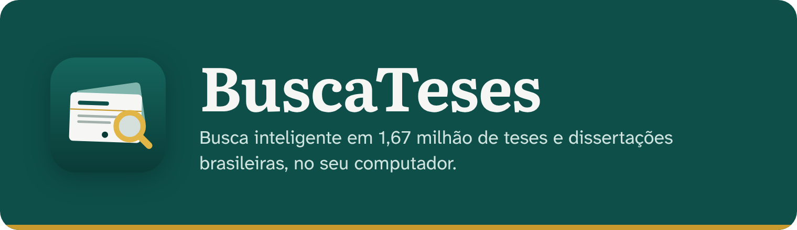
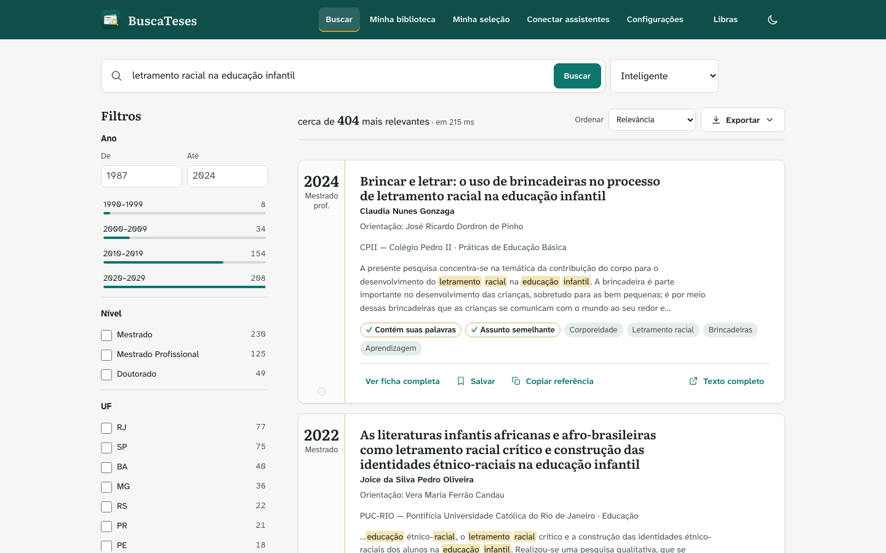
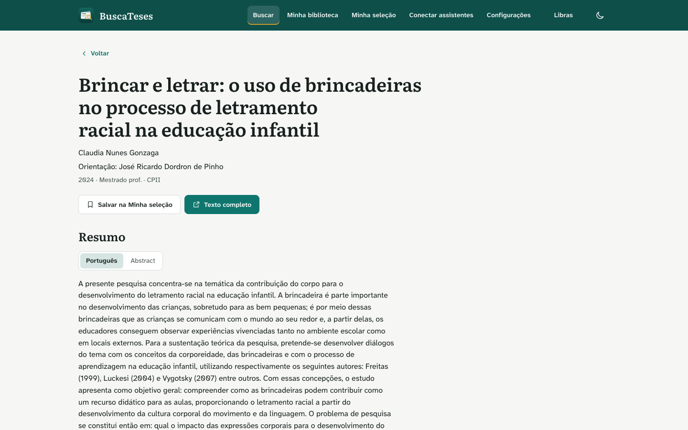
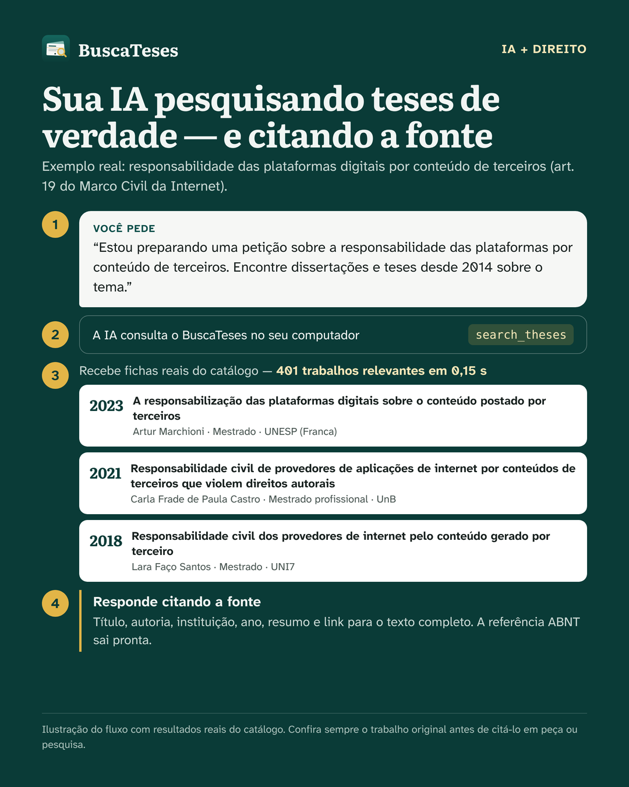
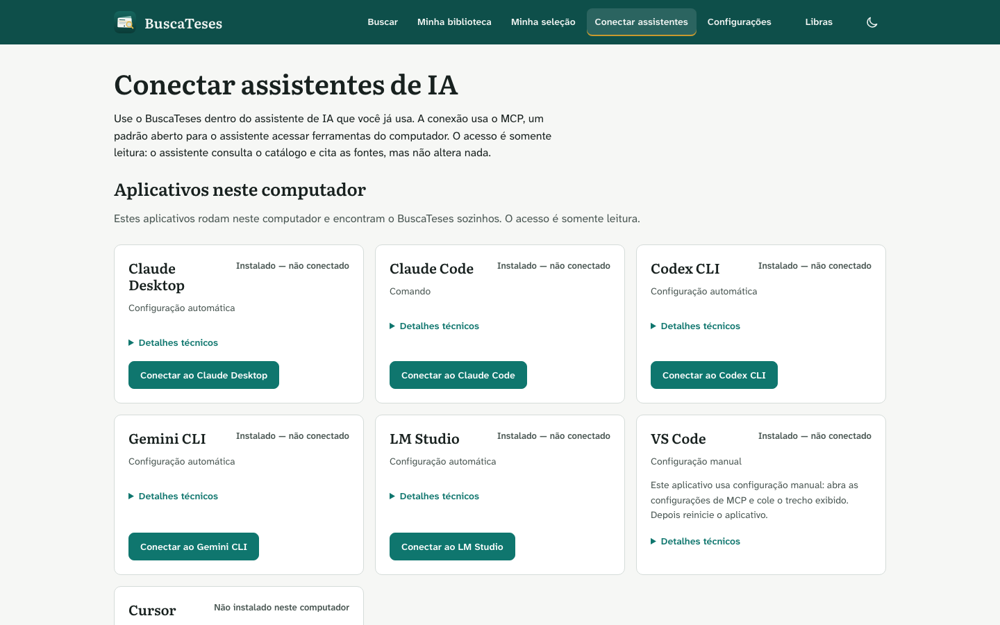
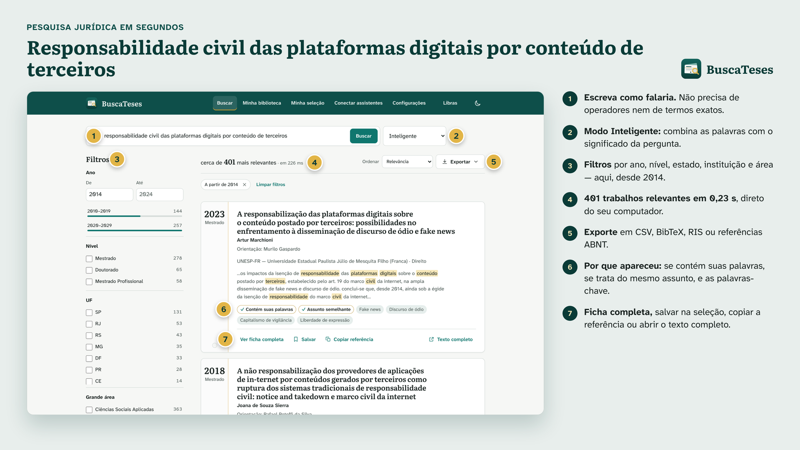
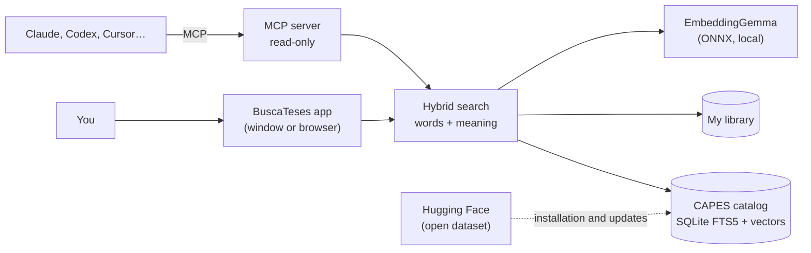

<p align="center">
  
</p>

<p align="center">
  <a href="https://github.com/andrebadini/buscateses-local/releases/latest"></a>
  <a href="https://github.com/andrebadini/buscateses-local/releases"></a>
  <a href="https://github.com/andrebadini/buscateses-local/actions/workflows/ci.yml"></a>
  <a href="LICENSE"></a>
  <a href="https://huggingface.co/datasets/andrebadini/catalogo-teses-capes"></a>
  
  <a href="docs/MCP.md"></a>
</p>

<p align="center"><a href="README.md">Português</a> · <b>English</b></p>

**BuscaTeses** is a free, open-source application for searching, on your own computer,
**1,670,528 theses and dissertations** defended in Brazil between **1987 and 2024**, based on the CAPES Catalog of
Theses and Dissertations. It understands the *meaning* of your question, not just the words, searches your **own books
and papers** as well, and talks to AI assistants such as **Claude, Codex, Cursor and Gemini** through the MCP protocol.

<p align="center">
  
</p>

## Why use it

- **Search that understands the subject.** Search for "violence against women in rural areas" and also find work on
  "gender and rurality", even without the same words. Search combines exact words and meaning.
- **Everything on your computer.** After downloading the catalog, nothing you search leaves your machine. No account,
  no ads, no tracking.
- **Researcher-grade filters.** Year, degree (master's, doctorate, professional), state, institution, broad area and
  knowledge area.
- **Cite in seconds.** Copy an ABNT reference or export to Zotero, Mendeley and EndNote (BibTeX, RIS, CSV).
- **Your personal library.** Add PDFs, EPUBs and Word documents and search inside them with the same intelligence.
- **Integrated with your AI assistant.** With one click, Claude Desktop, Cursor and others start querying the catalog
  and your library to answer your questions, citing the sources.
- **Readable.** CAPES records stored in UPPERCASE are displayed in normal case, with acronyms and accents restored.
- **Accessible.** Full keyboard navigation, screen-reader support, high contrast, dark theme and an optional Libras
  translator (VLibras), off by default.

## Screenshots

<table>
  <tr>
    <td width="50%"><br><sub>Full record, ABNT citation and similar works</sub></td>
    <td width="50%"><br><sub>Your AI searching and citing real theses through MCP</sub></td>
  </tr>
  <tr>
    <td width="50%"><br><sub>One-click connection to AI assistants</sub></td>
    <td width="50%"><br><sub>Legal research with filters and ABNT export</sub></td>
  </tr>
</table>

## Download

| System | File | Notes |
| --- | --- | --- |
| macOS with Apple silicon (M1 or newer) | [BuscaTeses-macos-arm64.dmg](https://github.com/andrebadini/buscateses-local/releases/latest/download/BuscaTeses-macos-arm64.dmg) | macOS 11 or newer |
| macOS with an Intel processor | [BuscaTeses-macos-x86_64.dmg](https://github.com/andrebadini/buscateses-local/releases/latest/download/BuscaTeses-macos-x86_64.dmg) | macOS 11 or newer |
| Windows 10 or 11 (64-bit) | [BuscaTeses-windows-x64-setup.exe](https://github.com/andrebadini/buscateses-local/releases/latest/download/BuscaTeses-windows-x64-setup.exe) | no administrator required |
| Linux (x86_64) | [BuscaTeses-linux-x86_64.tar.gz](https://github.com/andrebadini/buscateses-local/releases/latest/download/BuscaTeses-linux-x86_64.tar.gz) | native window or browser |

**You will need:** about **12 GB of free disk space**, 8 GB of RAM (recommended) and internet access on first
use, to download the catalog (~2.8 GB) and the embedding model (~330 MB). After that, the connection is only used to
check for updates (optional) and, if you enable it, to load VLibras.

<details>
<summary><b>macOS: the system says the app "cannot be opened"</b></summary>

BuscaTeses is free and does not have Apple's paid certificate, so macOS asks for confirmation the first time:

1. Open the `.dmg` file and drag **BuscaTeses** to the **Applications** folder.
2. In Applications, **right-click** (or Control-click) BuscaTeses and choose **Open**.
3. Confirm with **Open**. It opens normally from then on.

On macOS 15 or newer, if the option does not appear, go to **System Settings → Privacy & Security**, scroll to the
notice about BuscaTeses and click **Open Anyway**.
</details>

<details>
<summary><b>Windows: "Windows protected your PC" appeared</b></summary>

This SmartScreen warning appears for new programs without a paid certificate. Click **More info** and then
**Run anyway**. The installer does not require an administrator password and installs only for your user.
</details>

## First use

When you open BuscaTeses for the first time, the **Getting started** screen takes care of everything:

1. **Downloads the embedding model** that turns texts into vectors for meaning-based search (~330 MB). It runs on
   your computer.
2. **Downloads and organizes the thesis catalog** (~2.8 GB). It takes 10 to 40 minutes, depending on your
   internet connection and computer.
3. **Connects your AI assistants** (optional), with one click per assistant.

After that, BuscaTeses works offline. The connection is used only to download the model and the catalog, check for
updates (optional; it can be disabled in **Settings**) and, if you enable it, load VLibras. There is no telemetry, no
account and no upload of your searches or documents. When CAPES publishes new data, the app notifies you and updates
the catalog with one click.

## Install with the help of an AI assistant

If you use an assistant that runs commands on your computer (Claude Code, Claude Desktop with computer access, Codex,
Cursor, Gemini CLI, etc.), copy and paste the request below. The assistant follows the instructions in
[AGENTS.md](AGENTS.md), which was written for this.

```text
Install and configure BuscaTeses (https://github.com/andrebadini/buscateses-local) on this computer,
following the instructions in the repository's AGENTS.md file. I want:
1. the application installed from the latest version published in Releases (use the installer for my system);
2. the embedding model and the thesis catalog downloaded and ready (command "buscateses setup --yes");
3. the BuscaTeses MCP server connected to the assistant I use: [WRITE HERE: Claude Desktop, Claude Code,
   Codex, Cursor, Gemini CLI or LM Studio];
4. a final check with "buscateses status" and a test search.
Explain each step in plain language and ask for my confirmation before installing any program.
```

More ready-made requests are in [docs/PROMPTS.md](docs/PROMPTS.md) *(in Portuguese)*.

## How to search

- **Smart** (default): combines words and meaning. It is the best starting point.
- **Exact words**: only works that contain the terms. Use `"quotes"` for exact phrases and `-word` to exclude.
- **By meaning**: finds works close to the topic, even with different words.

Open the **full record** to read the abstract, see the metadata, copy the ABNT reference and discover **similar
works**. Save items to **My selection** and export everything at once.

> The ABNT reference is generated automatically from CAPES data. Double-check it before using it in your work.

## My library

Drag your PDF, EPUB, DOCX, TXT, Markdown or HTML files to the **My library** screen. BuscaTeses extracts the text,
splits it into passages and lets you search inside them by words and by meaning, showing the page of each passage.
The files stay only on your computer and are never sent anywhere. When you open a library file, PDFs appear in the
viewer; HTML, Markdown and TXT are shown as **plain text** (scripts are never executed); EPUB and DOCX are downloaded
as attachments.

Scanned PDFs made of images (without selectable text) must first go through an OCR program. See
[docs/BIBLIOTECA.md](docs/BIBLIOTECA.md) *(in Portuguese)*.

## Using it with AI assistants (MCP)

On the **Connect assistants** screen, click **Connect to <name>** on your assistant's card and restart it. You can
also do it from the terminal:

```bash
buscateses connect claude_desktop   # or: claude_code, codex, cursor, gemini_cli, lm_studio
buscateses connect --list           # shows the state of each assistant
```

To use **ChatGPT** or **Claude.ai**, scroll to **Web assistants** on the same screen and click **Create public
address**. BuscaTeses downloads the Cloudflare connector, creates a temporary address with a secret in its path and
shows the step-by-step for each assistant. The address only works while the app is open; click **Turn off** when you
are done. Your personal library is exposed only if you tick the option — by default, the web assistant sees the
catalog only.

On the macOS and Windows installers, the installed command-line executable is called `buscateses-cli`
(`/Applications/BuscaTeses.app/Contents/MacOS/buscateses-cli` and
`%LOCALAPPDATA%\Programs\BuscaTeses\buscateses-cli.exe`). On Linux and in source installations, the command is
`buscateses`. Adjust the examples on this page to your system.

Then simply ask, for example: *"Use BuscaTeses to find doctoral theses on family farming in the Cerrado defended after
2015 and summarize the main approaches, citing author, year and institution."*

The MCP server is **read-only** and exposes the tools `search_theses`, `get_thesis`, `similar_theses`,
`search_library`, `list_library_documents`, `get_library_passage` and `catalog_status`. Manual setup, remote access
and security: [docs/MCP.md](docs/MCP.md) *(in Portuguese)*.

## FAQ

<details><summary><b>Do I need to install LM Studio, Ollama or another program?</b></summary>

No. The embedding model (EmbeddingGemma, from Google) runs inside BuscaTeses itself. If you already use LM Studio or Ollama
and prefer them, configure them in **Settings → Embedding engine**.
</details>

<details><summary><b>How much space does it use? Can I delete anything later?</b></summary>

The installed catalog takes about 8 GB and the model takes 330 MB. Files downloaded for the
installation are deleted automatically at the end. The data folder is `~/Library/Application Support/BuscaTeses`
(macOS), `%LOCALAPPDATA%\BuscaTeses` (Windows) or `~/.local/share/BuscaTeses` (Linux).
</details>

<details><summary><b>Does BuscaTeses include the full text of the theses?</b></summary>

No. The CAPES catalog provides title, authorship, advising, abstract, keywords and other metadata. When CAPES provides
a link to the full text, the **Full text** button opens the original page. You can download the PDF and add it to your
library to search inside it.
</details>

<details><summary><b>Does it work offline?</b></summary>

Yes, after installation. The internet is used only to download the catalog and the model, check for updates (you can
disable this in **Settings → Application updates**) and load VLibras — the latter only if you enable the **Libras**
button, which is off by default. Searches, favorites, your library and exports never leave your computer; there is no
telemetry.
</details>

<details><summary><b>How do I uninstall it?</b></summary>

macOS: drag the app to the Trash and, if you want, delete the data folder listed above. Windows: **Settings → Apps →
BuscaTeses → Uninstall** (the uninstaller asks whether to delete your data). Linux: delete `~/.local/opt/buscateses`
and the data folder.
</details>

More answers in [docs/SOLUCAO-DE-PROBLEMAS.md](docs/SOLUCAO-DE-PROBLEMAS.md) *(in Portuguese)*.

## The data

The catalog comes from [CAPES open data](https://dadosabertos.capes.gov.br) (Catalog of Theses and Dissertations,
Creative Commons Attribution license), normalized and enriched with semantic vectors. The ready-to-use version is
published as an open dataset on Hugging Face:
**[andrebadini/catalogo-teses-capes](https://huggingface.co/datasets/andrebadini/catalogo-teses-capes)**, which can be
used in other research projects (pandas, DuckDB, `datasets`). Personal data such as national ID numbers and internal
identifiers have been removed. The whole process is reproducible with the scripts in [`tools/dataset`](tools/dataset).

## How it works



Technical details in [docs/ARQUITETURA.md](docs/ARQUITETURA.md) *(in Portuguese)*.

## For developers

```bash
git clone https://github.com/andrebadini/buscateses-local.git
cd buscateses-local
uv venv && uv pip install -e ".[dev,desktop]"
uv run buscateses setup --yes      # downloads the model and catalog
uv run buscateses                  # opens the app
uv run pytest -m "not slow"        # tests
```

Full guide, conventions and how to build installers: [CONTRIBUTING.md](CONTRIBUTING.md) and
[docs/DESENVOLVIMENTO.md](docs/DESENVOLVIMENTO.md) *(in Portuguese)*.

## License, credits and disclaimer

- Code: [MIT](LICENSE).
- Data: CAPES — Catalog of Theses and Dissertations, [Creative Commons Attribution](https://dadosabertos.capes.gov.br).
- Model: [EmbeddingGemma](https://huggingface.co/google/embeddinggemma-300m), from Google, subject to the
  [Gemma Terms of Use](https://ai.google.dev/gemma/terms); ONNX version by
  [onnx-community](https://huggingface.co/onnx-community/embeddinggemma-300m-ONNX).
- Fonts Literata and Atkinson Hyperlegible Next: [SIL Open Font License 1.1](LICENSES/OFL-1.1.txt).
- Libras accessibility: [VLibras](https://vlibras.gov.br).

Full credits in [THIRD_PARTY_NOTICES.md](THIRD_PARTY_NOTICES.md).

BuscaTeses is an independent project, **not affiliated with CAPES**, Google or any institution mentioned.

If BuscaTeses helped your research, cite it (see [CITATION.cff](CITATION.cff)) and leave a ⭐ on the repository.
