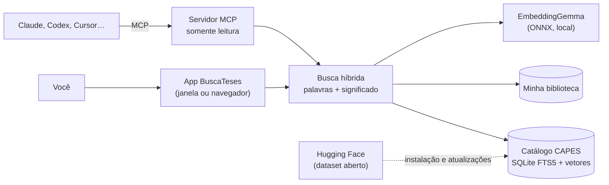

<p align="center">
  
</p>

<p align="center">
  <a href="https://github.com/andrebadini/buscateses-local/releases/latest"></a>
  <a href="https://github.com/andrebadini/buscateses-local/releases"></a>
  <a href="https://github.com/andrebadini/buscateses-local/actions/workflows/ci.yml"></a>
  <a href="LICENSE"></a>
  <a href="https://huggingface.co/datasets/andrebadini/catalogo-teses-capes"></a>
  
  <a href="docs/MCP.md"></a>
</p>

<p align="center"><b>Português</b> · <a href="README.en.md">English</a></p>

O **BuscaTeses** é um aplicativo gratuito e de código aberto para pesquisar, no seu próprio computador,
**1.670.528 teses e dissertações** defendidas no Brasil entre **1987 e 2024**, a partir do Catálogo de Teses e
Dissertações da CAPES. Ele entende o *sentido* da sua pergunta, não só as palavras, pesquisa também nos **seus
próprios livros e artigos** e conversa com assistentes de IA como **Claude, Codex, Cursor e Gemini** por meio
do protocolo MCP.

<p align="center">
  
</p>

## Por que usar

- **Busca que entende o assunto.** Pesquise "violência contra a mulher no campo" e encontre também trabalhos sobre
  "gênero e ruralidade", mesmo sem as mesmas palavras. A busca combina palavras exatas e significado.
- **Tudo no seu computador.** Depois de baixar o catálogo, nada do que você pesquisa sai da sua máquina. Sem conta, sem
  anúncios, sem rastreamento.
- **Filtros de pesquisador.** Ano, nível (mestrado, doutorado, profissional), estado, instituição, grande área e área do
  conhecimento.
- **Cite em segundos.** Copie a referência no padrão ABNT ou exporte para Zotero, Mendeley e EndNote (BibTeX, RIS, CSV).
- **Sua biblioteca pessoal.** Adicione PDFs, EPUBs e documentos do Word e pesquise dentro deles com a mesma inteligência.
- **Integrado ao seu assistente de IA.** Com um clique, o Claude Desktop, o Cursor e outros passam a consultar o catálogo e
  a sua biblioteca para responder às suas perguntas, citando as fontes.
- **Legível.** Os registros da CAPES em CAIXA ALTA são exibidos em caixa normal, com siglas e acentos restaurados.
- **Acessível.** Navegação completa por teclado, leitor de tela, alto contraste, tema escuro e tradutor de Libras
  (VLibras) opcional, desligado por padrão.

## Telas

<table>
  <tr>
    <td width="50%"><br><sub>Ficha completa, referência ABNT e trabalhos semelhantes</sub></td>
    <td width="50%"><br><sub>Sua IA pesquisando e citando teses reais pelo MCP</sub></td>
  </tr>
  <tr>
    <td width="50%"><br><sub>Conexão com assistentes de IA em um clique</sub></td>
    <td width="50%"><br><sub>Pesquisa jurídica com filtros e exportação em ABNT</sub></td>
  </tr>
</table>

## Baixar

| Sistema | Arquivo | Observação |
| --- | --- | --- |
| macOS com chip Apple (M1 ou mais recente) | [BuscaTeses-macos-arm64.dmg](https://github.com/andrebadini/buscateses-local/releases/latest/download/BuscaTeses-macos-arm64.dmg) | macOS 11 ou mais recente |
| macOS com processador Intel | [BuscaTeses-macos-x86_64.dmg](https://github.com/andrebadini/buscateses-local/releases/latest/download/BuscaTeses-macos-x86_64.dmg) | macOS 11 ou mais recente |
| Windows 10 ou 11 (64 bits) | [BuscaTeses-windows-x64-setup.exe](https://github.com/andrebadini/buscateses-local/releases/latest/download/BuscaTeses-windows-x64-setup.exe) | não exige administrador |
| Linux (x86_64) | [BuscaTeses-linux-x86_64.tar.gz](https://github.com/andrebadini/buscateses-local/releases/latest/download/BuscaTeses-linux-x86_64.tar.gz) | janela nativa ou navegador |

**Você vai precisar de:** cerca de **12 GB livres** em disco, 8 GB de memória RAM (recomendado) e internet na
primeira vez, para baixar o catálogo (~2,8 GB) e o modelo de embedding (~330 MB). Depois, a conexão só é usada para
verificar atualizações (opcional) e, se você ativar, carregar o VLibras.

<details>
<summary><b>macOS: o sistema diz que o app "não pode ser aberto"</b></summary>

O BuscaTeses é gratuito e não tem o certificado pago da Apple, por isso o macOS pede uma confirmação na primeira vez:

1. Abra o arquivo `.dmg` e arraste o **BuscaTeses** para a pasta **Aplicativos**.
2. Na pasta Aplicativos, clique no BuscaTeses com o **botão direito** (ou Control + clique) e escolha **Abrir**.
3. Confirme em **Abrir**. Nas próximas vezes, ele abre normalmente.

No macOS 15 ou mais recente, se não aparecer a opção, vá em **Ajustes do Sistema → Privacidade e Segurança**, role até o
aviso sobre o BuscaTeses e clique em **Abrir Mesmo Assim**.
</details>

<details>
<summary><b>Windows: apareceu "O Windows protegeu o computador"</b></summary>

Esse aviso do SmartScreen aparece para programas novos sem certificado pago. Clique em **Mais informações** e depois em
**Executar assim mesmo**. O instalador não pede senha de administrador e instala só para o seu usuário.
</details>

## Primeiro uso

Ao abrir o BuscaTeses pela primeira vez, a tela **Primeiros passos** cuida de tudo:

1. **Baixa o modelo de embedding** que transforma textos em vetores para a busca por significado (~330 MB). Ele roda
   no seu computador.
2. **Baixa e organiza o catálogo** de teses (~2,8 GB). Leva de 10 a 40 minutos, conforme a internet e o computador.
3. **Conecta seus assistentes de IA** (opcional), com um clique por assistente.

Depois disso, o BuscaTeses funciona sem internet. A conexão é usada apenas para baixar o modelo e o catálogo, verificar
atualizações (opcional; pode ser desligada em **Configurações**) e, se você ativar, carregar o VLibras. Não há
telemetria, conta ou envio das suas buscas e dos seus documentos. Quando a CAPES publicar dados novos, o app avisa e
atualiza o catálogo com um clique.

## Instalar com a ajuda de um assistente de IA

Se você usa um assistente que executa comandos no computador (Claude Code, Claude Desktop com acesso ao computador,
Codex, Cursor, Gemini CLI, etc.), copie e cole o pedido abaixo. O assistente segue as instruções do arquivo
[AGENTS.md](AGENTS.md), feito para isso.

```text
Instale e configure o BuscaTeses (https://github.com/andrebadini/buscateses-local) neste computador,
seguindo as instruções do arquivo AGENTS.md do repositório. Quero:
1. o aplicativo instalado pela versão mais recente publicada em Releases (use o instalador do meu sistema);
2. o modelo de embedding e o catálogo de teses baixados e prontos (comando "buscateses setup --yes");
3. o servidor MCP do BuscaTeses conectado ao assistente que eu uso: [ESCREVA AQUI: Claude Desktop, Claude Code,
   Codex, Cursor, Gemini CLI ou LM Studio];
4. uma verificação final com "buscateses status" e uma busca de teste.
Explique cada passo em linguagem simples e peça minha confirmação antes de instalar qualquer programa.
```

Outros pedidos prontos estão em [docs/PROMPTS.md](docs/PROMPTS.md).

## Como pesquisar

- **Inteligente** (padrão): combina palavras e significado. É o melhor ponto de partida.
- **Palavras exatas**: só trabalhos que contêm os termos. Use `"aspas"` para frases exatas e `-palavra` para excluir.
- **Por significado**: encontra trabalhos próximos ao tema, mesmo com outras palavras.

Abra a **ficha completa** para ler o resumo, ver os metadados, copiar a referência ABNT e descobrir **trabalhos
semelhantes**. Salve itens em **Minha seleção** e exporte tudo de uma vez.

> A referência ABNT é gerada automaticamente a partir dos dados da CAPES. Confira-a antes de usar em um trabalho.

## Minha biblioteca

Arraste para a tela **Minha biblioteca** seus arquivos PDF, EPUB, DOCX, TXT, Markdown ou HTML. O BuscaTeses extrai o
texto, divide em trechos e permite pesquisar dentro deles por palavras e por significado, mostrando a página de cada
trecho. Os arquivos ficam somente no seu computador e nunca são enviados para lugar nenhum. Ao abrir um arquivo da
biblioteca, PDFs aparecem no visualizador; HTML, Markdown e TXT são mostrados como **texto simples** (sem executar
scripts); EPUB e DOCX são baixados como anexo.

PDFs digitalizados como imagem (sem texto selecionável) precisam passar antes por um programa de OCR.
Detalhes em [docs/BIBLIOTECA.md](docs/BIBLIOTECA.md).

## Usar com assistentes de IA (MCP)

Na tela **Conectar assistentes**, clique em **Conectar ao <nome>** no cartão do seu assistente e reinicie-o. Também é
possível pelo terminal:

```bash
buscateses connect claude_desktop   # ou: claude_code, codex, cursor, gemini_cli, lm_studio
buscateses connect --list           # mostra o estado de cada assistente
```

Para usar no **ChatGPT** ou no **Claude.ai**, role até **Assistentes na web** na mesma tela e clique em **Criar
endereço público**. O BuscaTeses baixa o conector da Cloudflare, cria um endereço temporário com um segredo no caminho
e mostra o passo a passo de cada assistente. O endereço só funciona enquanto o app estiver aberto; clique em
**Desligar** ao terminar. A biblioteca pessoal só é exposta se você marcar a opção — por padrão, o assistente na web
vê apenas o catálogo.

Nos instaladores de macOS e Windows, o executável de linha de comando instalado chama-se `buscateses-cli`
(`/Applications/BuscaTeses.app/Contents/MacOS/buscateses-cli` e
`%LOCALAPPDATA%\Programs\BuscaTeses\buscateses-cli.exe`). No Linux e nas instalações por código-fonte, o comando é
`buscateses`. Ajuste os exemplos desta página ao seu sistema.

Depois, é só pedir, por exemplo: *"Use o BuscaTeses para encontrar teses de doutorado sobre agricultura familiar no
Cerrado defendidas depois de 2015 e resuma as principais abordagens, citando autor, ano e instituição."*

O servidor MCP é **somente leitura** e oferece as ferramentas `search_theses`, `get_thesis`, `similar_theses`,
`search_library`, `list_library_documents`, `get_library_passage` e `catalog_status`. Configuração manual, acesso
remoto e segurança: [docs/MCP.md](docs/MCP.md).

## Perguntas frequentes

<details><summary><b>Preciso instalar o LM Studio, o Ollama ou outro programa?</b></summary>

Não. O modelo de embedding (EmbeddingGemma, do Google) roda dentro do próprio BuscaTeses. Se você já usa LM Studio ou Ollama e
prefere usá-los, configure em **Configurações → Motor de embedding**.
</details>

<details><summary><b>Quanto espaço ocupa? Posso apagar algo depois?</b></summary>

O catálogo instalado ocupa cerca de 8 GB e o modelo, 330 MB. Os arquivos baixados para a instalação são
apagados automaticamente ao final. A pasta de dados fica em `~/Library/Application Support/BuscaTeses` (macOS),
`%LOCALAPPDATA%\BuscaTeses` (Windows) ou `~/.local/share/BuscaTeses` (Linux).
</details>

<details><summary><b>O BuscaTeses tem o texto completo das teses?</b></summary>

Não. O catálogo da CAPES traz título, autoria, orientação, resumo, palavras-chave e outros metadados. Quando a CAPES
informa um link para o texto completo, o botão **Texto completo** abre a página de origem. Você pode baixar o PDF e
adicioná-lo à sua biblioteca para pesquisar dentro dele.
</details>

<details><summary><b>Funciona sem internet?</b></summary>

Sim, depois da instalação. A internet é usada só para baixar o catálogo e o modelo, procurar atualizações (você pode
desligar essa verificação em **Configurações → Atualizações do aplicativo**) e carregar o VLibras — este último apenas
se você ativar o botão **Libras**, que vem desligado por padrão. Buscas, favoritos, biblioteca e exportações nunca saem
do seu computador; não há telemetria.
</details>

<details><summary><b>Como desinstalar?</b></summary>

macOS: arraste o app para o Lixo e, se quiser, apague a pasta de dados indicada acima. Windows: **Configurações →
Aplicativos → BuscaTeses → Desinstalar** (o desinstalador pergunta se deve apagar os dados). Linux: apague
`~/.local/opt/buscateses` e a pasta de dados.
</details>

Mais respostas em [docs/SOLUCAO-DE-PROBLEMAS.md](docs/SOLUCAO-DE-PROBLEMAS.md).

## Os dados

O catálogo vem dos [dados abertos da CAPES](https://dadosabertos.capes.gov.br) (Catálogo de Teses e Dissertações,
licença Creative Commons Atribuição), normalizado e enriquecido com vetores semânticos. A versão pronta para uso está
publicada como dataset aberto no Hugging Face: **[andrebadini/catalogo-teses-capes](https://huggingface.co/datasets/andrebadini/catalogo-teses-capes)**,
que pode ser usado em outras pesquisas (pandas, DuckDB, `datasets`). Dados pessoais como CPF e identificadores internos
foram removidos. Todo o processo é reprodutível com os scripts em [`tools/dataset`](tools/dataset).

## Como funciona



Detalhes técnicos em [docs/ARQUITETURA.md](docs/ARQUITETURA.md).

## Para desenvolvedores

```bash
git clone https://github.com/andrebadini/buscateses-local.git
cd buscateses-local
uv venv && uv pip install -e ".[dev,desktop]"
uv run buscateses setup --yes      # baixa modelo e catálogo
uv run buscateses                  # abre o app
uv run pytest -m "not slow"        # testes
```

Guia completo, convenções e como gerar instaladores: [CONTRIBUTING.md](CONTRIBUTING.md) e
[docs/DESENVOLVIMENTO.md](docs/DESENVOLVIMENTO.md).

## Licença, créditos e aviso

- Código: [MIT](LICENSE).
- Dados: CAPES — Catálogo de Teses e Dissertações, [Creative Commons Atribuição](https://dadosabertos.capes.gov.br).
- Modelo: [EmbeddingGemma](https://huggingface.co/google/embeddinggemma-300m), do Google, sujeito aos
  [Termos de Uso do Gemma](https://ai.google.dev/gemma/terms); versão ONNX de
  [onnx-community](https://huggingface.co/onnx-community/embeddinggemma-300m-ONNX).
- Fontes Literata e Atkinson Hyperlegible Next: [SIL Open Font License 1.1](LICENSES/OFL-1.1.txt).
- Acessibilidade em Libras: [VLibras](https://vlibras.gov.br).

Créditos completos em [THIRD_PARTY_NOTICES.md](THIRD_PARTY_NOTICES.md).

O BuscaTeses é um projeto independente, **sem vínculo com a CAPES**, o Google ou qualquer instituição citada.

Se o BuscaTeses ajudou na sua pesquisa, cite-o (veja [CITATION.cff](CITATION.cff)) e deixe uma ⭐ no repositório.
