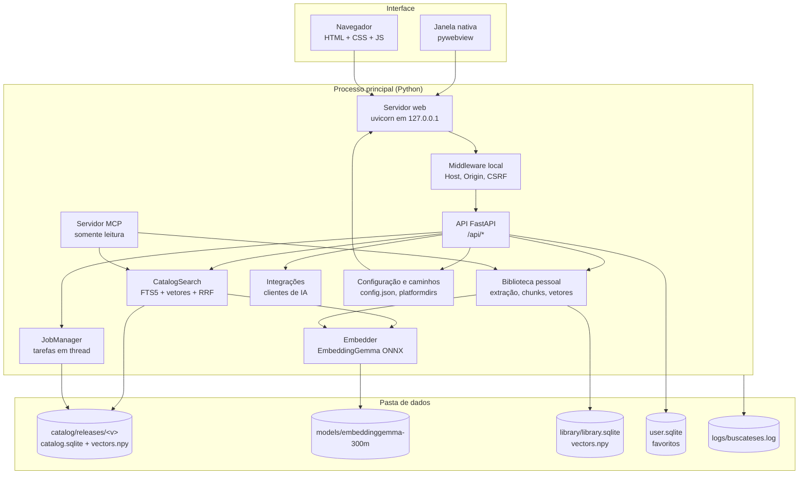
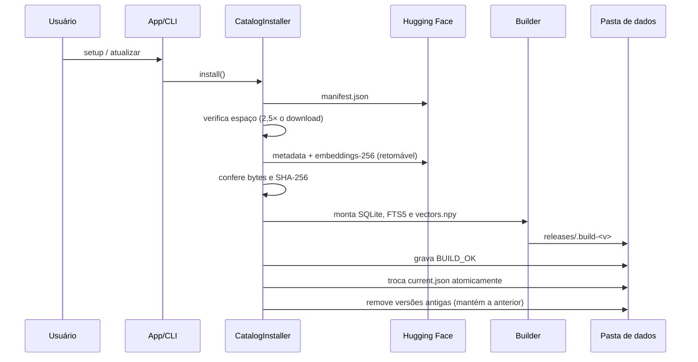
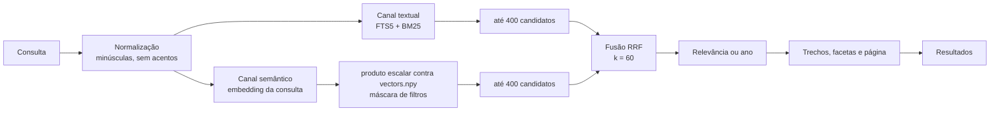

# Arquitetura

Este documento descreve como o BuscaTeses é construído. Ele é voltado a quem vai manter ou auditar o código. A
especificação interna completa está em [dev/ESPECIFICACAO.md](dev/ESPECIFICACAO.md).

## Visão geral

O BuscaTeses é um aplicativo Python que roda inteiramente no computador da pessoa usuária. Há três formas de acessá-lo:

- **janela nativa** (pywebview), que inicia um servidor local em segundo plano;
- **navegador**, em `http://127.0.0.1:8101`;
- **servidor MCP**, por stdio ou HTTP local, para assistentes de IA.



Pontos importantes:

- o servidor HTTP escuta **somente** em `127.0.0.1`; não há modo de rede;
- não há contas, telemetria ou banco remoto;
- a interface é estática (sem etapa de build no frontend);
- o MCP é somente leitura e compartilha a mesma camada de busca do app;
- a internet é usada apenas para baixar modelo/catálogo, verificar atualizações (desligável) e, se ativado, carregar o
  VLibras opcional.

## Componentes

| Módulo | Responsabilidade |
| --- | --- |
| `config.py` | caminhos da pasta de dados (`platformdirs`) e leitura/escrita de `config.json` |
| `jobs.py` | tarefas em thread com progresso consultável, sem estado global oculto |
| `catalog/manifest.py` | validação estrita do `manifest.json` do dataset |
| `catalog/installer.py` | download, verificação, build, troca atômica e rollback |
| `catalog/builder.py` | Parquet → SQLite/FTS5 + `vectors.npy` + facetas |
| `catalog/search.py` | busca textual, semântica e híbrida; filtros, facetas, similares |
| `embeddings/` | `Embedder` (protocolo), ONNX local e servidor compatível com OpenAI |
| `library/` | extração por página, chunking, armazenamento e busca híbrida |
| `exporters.py` | CSV, BibTeX, RIS e referência ABNT |
| `favorites.py` | "Minha seleção" em `user.sqlite` |
| `integrations.py` | configuração automática do MCP nos clientes |
| `mcp_server.py` | ferramentas MCP (stdio e Streamable HTTP) |
| `api/` | rotas FastAPI, segurança local e estáticos |
| `desktop.py` | janela pywebview, instância única e fallback para navegador |
| `cli.py` | subcomandos `app`, `serve`, `setup`, `update`, `status`, `search`, `library`, `mcp`, `connect`… |
| `textcase.py` | restauração de caixa e acentos dos registros da CAPES |

## Fluxo de instalação do catálogo



O download usa `huggingface_hub`, com retomada e até três tentativas. A verificação compara tamanho e SHA-256 com o
manifesto. O build acontece em um diretório temporário; só depois de validado ele é movido para
`catalog/releases/<versão>`. A ativação é uma escrita atômica de `current.json` (`os.replace`). Se qualquer etapa
falhar, a versão anterior continua ativa.

## Formatos de dados

### Catálogo: SQLite FTS5

O formato atual é o **v2** (resumos com zlib, FTS5 contentless e vetores float16); o `meta.format_version` permite ler
catálogos v1 até a próxima reconstrução. Cada release tem um `catalog.sqlite` com:

- **`theses`** — um registro por tese/dissertação. Resumos são comprimidos com zlib (nível 6) para reduzir o arquivo.
- **`theses_fts`** — índice FTS5 *contentless* (`content=''`), com as colunas `title`, `keywords`, `abstract`,
  `author`, `advisors`, `program`, `institution` e tokenizador `unicode61 remove_diacritics 2`. Os pesos do BM25 são
  `(8, 4, 1, 3, 2, 1, 1)`: título e palavras-chave pesam mais.
- **`facets`** — contagens por grau, UF, grande área, área do conhecimento, instituição e ano.
- **`meta`** — versão, número de registros, data de build, `format_version`, tipo dos vetores e dimensões.
- índices SQL em ano, grau, UF, sigla da instituição, grande área e área do conhecimento.

O índice é *contentless* porque o texto completo já está na tabela `theses`; isso evita duplicar resumos. Como o FTS5
não oferece `snippet()` nesse modo, os trechos destacados são gerados em Python.

### Vetores: numpy

`vectors.npy` é um `memmap` `float16` com forma `[N, 256]`. A linha `i` corresponde ao `rowid i+1` da tabela `theses`.
O alinhamento é garantido na construção: todo `id` dos metadados precisa ter um embedding; registros sem vetor recebem
um vetor zero e são contados em `meta.missing_vectors`.

Os vetores de 256 dimensões são a **projeção Matryoshka** do modelo: o EmbeddingGemma produz 768 dimensões e os
primeiros 256 valores são re-normalizados em L2. Isso reduz o armazenamento e o custo da busca sem perder a maior
parte da qualidade.

### Modelo: EmbeddingGemma ONNX

O app baixa do repositório `onnx-community/embeddinggemma-300m-ONNX`:

```text
models/embeddinggemma-300m/
  tokenizer.json
  onnx/model_quantized.onnx
  onnx/model_quantized.onnx_data
  READY
```

O `onnxruntime` executa o modelo localmente. A saída usada é `sentence_embedding`; as entradas são `input_ids` e
`attention_mask` (`int64`), com truncamento em 2048 tokens e lotes de 16. O carregamento é preguiçoso e
thread-safe. A variante padrão é a quantizada (~300 MB); a `fp32` é opcional.

Textos de documento seguem o formato `title: {título} | text: {resumo ou palavras-chave}`. Consultas usam
`task: search result | query: {consulta}`. Esses prefixos fazem parte do contrato do modelo e são aplicados também
quando o motor é um servidor externo compatível com a API OpenAI.

## Busca híbrida



Detalhes:

- **Consulta textual segura.** A entrada é tokenizada em letras e dígitos. Frases entre aspas viram uma expressão
  exata; termos com `-` viram exclusões. Cada token é colocado entre aspas antes de entrar na expressão FTS5, então a
  sintaxe crua da pessoa usuária nunca é executada. O escopo (`title`, `abstract`, etc.) vira um filtro de coluna.
- **AND antes de OR.** A primeira tentativa usa todos os termos (AND). Se não houver resultado, os termos são
  combinados com OR e a resposta indica `relaxed: true`.
- **Vetores com filtros.** As máscaras por ano, grau, UF, instituição, grande área e área são pré-computadas em arrays
  numpy e aplicadas antes da seleção dos candidatos. A varredura é feita em blocos de 262.144 linhas para limitar a
  memória.
- **RRF.** Cada canal contribui com `1 / (60 + posição)`. O resultado final soma as duas contribuições. É uma forma
  simples e robusta de combinar rankings com escalas diferentes, sem precisar calibrar pesos.
- **Sem modelo.** Se o embedding não estiver disponível, o modo híbrido cai para textual e devolve o aviso
  `semantic_unavailable`.

## Normalização de caixa (textcase)

O catálogo da CAPES tem muitos registros em CAIXA ALTA, sem acentos nos anos mais antigos. O módulo `textcase.py`:

- detecta texto "gritado" por uma proporção de maiúsculas e um número mínimo de letras;
- restaura acentos e caixa usando um léxico gerado a partir dos próprios metadados
  (`src/buscateses/data/truecase.json`);
- preserva siglas, códigos de UF, números romanos e nomes próprios conhecidos;
- em títulos mistos, converte **por segmento** (separadores `. `, `: `, ` - `, ` — `, `? ` e `! `): um trecho gritado
  com pelo menos 12 letras é normalizado, enquanto trechos já em caixa normal são mantidos exatamente como estão;
- **não altera** textos que já estão em caixa mista sem nenhum trecho gritado (conteúdo digitado pela pessoa usuária).

A normalização é usada na exibição e na geração dos embeddings do dataset, o que reduz tokens e melhora a recuperação.
Os metadados publicados no Hugging Face permanecem como vieram da CAPES.

## Segurança local

O modelo de ameaça assume que o computador pode ter outros programas e páginas abertas. As proteções são:

- **Host permitido.** O servidor só aceita `Host: 127.0.0.1:<porta>` ou `localhost:<porta>`. Isso bloqueia ataques de
  DNS rebinding que tentam fazer o navegador acessar o servidor local por outro nome.
- **CSRF.** Métodos que alteram estado (`POST`, `PUT`, `PATCH`, `DELETE`) exigem o cabeçalho `X-BuscaTeses: 1` e uma
  `Origin` ausente ou igual ao host local. Formulários de outros sites não conseguem enviar esse cabeçalho.
- **CORS desativado.** Não há cabeçalhos que liberem outros sites a ler respostas.
- **Uploads** têm limite de tamanho e validação de formato.
- **MCP HTTP** exige `Authorization: Bearer <token>` (comparação em tempo constante) e escuta apenas em `127.0.0.1`.
  Sem token, o servidor gera um aleatório e o salva em `config.json`.
- **MCP somente leitura.** A biblioteca é aberta em modo somente leitura pelo servidor MCP.
- **Sem segredos no código.** Tokens e chaves ficam na pasta de dados da pessoa usuária. `GET /api/settings` nunca os
  devolve: expõe apenas `has_api_key` e `token_set`, e um campo secreto vazio em `PUT` preserva o valor gravado.
- **Arquivos da biblioteca.** PDFs são servidos inline; HTML/MD/TXT saem como `text/plain`; EPUB/DOCX como anexo. Todas
  as respostas usam `nosniff` e CSP `sandbox`, então um HTML enviado pela pessoa usuária nunca executa scripts.
- **VLibras opcional.** Desligado por padrão; o script de `vlibras.gov.br` só é carregado após ativação explícita no
  botão **Libras** ou nas Configurações, e a preferência fica em `localStorage`.

O que **não** é protegido: qualquer processo rodando como o mesmo usuário pode ler a pasta de dados. Isso é inerente
a um aplicativo local.

## Tarefas (jobs)

O `JobManager` mantém tarefas em memória, cada uma em uma thread. Cada job tem `kind`, `status`, `stage`, mensagem em
português, progresso (0–1 ou nulo), bytes/registros e timestamps. As etapas típicas do catálogo são `download`,
`verify`, `build_db`, `build_index` e `finalize`. A biblioteca usa etapas de extração, chunking, embeddings e gravação.

Jobs não são persistidos: se o app for encerrado, a tela perde o progresso, mas o `setup` é idempotente e retoma pelo
download/cache. Tipos exclusivos (por exemplo, instalar o catálogo) não rodam em duplicidade.

## Empacotamento

O build é feito por `packaging/build.py` e produz um instalador por sistema:

| Sistema | Tecnologia | Artefato |
| --- | --- | --- |
| macOS | PyInstaller + `hdiutil`, assinatura ad-hoc | `BuscaTeses-macos-<arch>.dmg` |
| Windows | PyInstaller + Inno Setup 6 | `BuscaTeses-windows-x64-setup.exe` |
| Linux | PyInstaller + `tar.gz` + `install.sh` | `BuscaTeses-linux-x86_64.tar.gz` |

Cada pacote contém **dois executáveis**:

- `BuscaTeses` — a janela nativa (sem console);
- `buscateses-cli` (macOS/Windows) ou `buscateses` (Linux) — o cliente de console usado pelo MCP.

O sufixo `-cli` existe porque macOS e Windows não diferenciam maiúsculas de minúsculas; `BuscaTeses` e `buscateses`
seriam o mesmo arquivo. O Linux usa o nome sem sufixo.

O PyInstaller coleta apenas o necessário: as dependências opcionais pesadas (PyTorch, Transformers, pandas, DuckDB,
`mcp.cli`) ficam de fora. O instalador do Windows é por usuário (`PrivilegesRequired=lowest`), e o desinstalador
pergunta antes de apagar a pasta de dados. O DMG é assinado ad-hoc, não notarizado; por isso o macOS exibe o aviso do
Gatekeeper na primeira abertura.

A release é sempre manual: `gh workflow run release.yml -f tag=vX.Y.Z`. O workflow valida a versão do pacote, compila
os quatro instaladores, recalcula `SHA256SUMS.txt`, extrai as notas do `CHANGELOG.md` e cria a tag e o GitHub Release.

## Decisões e alternativas descartadas

| Decisão | Por quê | Alternativa descartada |
| --- | --- | --- |
| Aplicativo local com FastAPI + interface web | reaproveita Python, permite CLI e navegador, sem servidor remoto | Electron (instalador muito maior, duas linguagens) |
| pywebview para a janela | usa o motor do sistema, sem Chromium embutido | empacotar um navegador completo |
| Frontend sem build | menos ferramentas para contribuir e depurar | React/Vite com bundler |
| SQLite FTS5 | vem no Python, é rápido e não exige serviço | Elasticsearch/Meilisearch (servidor extra) |
| Vetores em numpy com varredura em blocos | simples, sem dependência nativa e rápido o bastante para ~1 milhão de linhas | FAISS/HNSW (complexidade e ganho pequeno nessa escala) |
| EmbeddingGemma ONNX quantizado | roda em CPU, ~300 MB, sem PyTorch | modelo maior com GPU (inviável para o público) |
| Matryoshka 256 | reduz disco e memória mantendo a qualidade | guardar 768 dimensões (3× mais espaço) |
| Busca híbrida com RRF | combina dois rankings sem calibrar pesos | soma ponderada de escores (escalas incompatíveis) |
| zlib nos resumos | reduz o SQLite sem dependência extra | guardar texto puro (arquivo maior) |
| OCR fora do escopo | manter o app leve e previsível | embutir Tesseract (pesado e difícil de empacotar) |
| Sem telemetria | privacidade é um requisito do produto | analytics de uso |
| Atualização manual do app | simplicidade e controle da pessoa usuária; evita auto-update frágil | atualizador automático |
| Um único `config.json` | fácil de inspecionar e versionar | banco de configuração proprietário |

## Limitações conhecidas

- A busca semântica depende de um modelo de 300 MB; sem ele, só a busca textual funciona.
- O catálogo não contém o texto completo das teses, apenas metadados e links quando a CAPES os informa.
- PDFs digitalizados exigem OCR externo.
- A varredura vetorial é linear; em computadores muito antigos, a primeira busca pode levar alguns segundos.
- O formato do catálogo é versionado (`format_version`); releases antigas continuam legíveis, mas são reconstruídas na
  próxima atualização.
