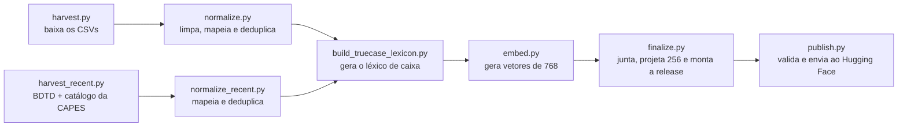

# Os dados

O BuscaTeses usa os **dados abertos do Catálogo de Teses e Dissertações da CAPES** até 2024 e, para os anos seguintes,
a **consulta pública do mesmo catálogo** e a **BDTD (IBICT)**. Publica uma versão normalizada, com vetores semânticos, no
Hugging Face. Este documento explica a origem, a licença, o esquema e como reproduzir o processo.

- Dataset: <https://huggingface.co/datasets/andrebadini/catalogo-teses-capes>
- Dados abertos da CAPES: <https://dadosabertos.capes.gov.br>
- Consulta pública do Catálogo da CAPES: <https://catalogodeteses.capes.gov.br/catalogo-teses/>
- BDTD (IBICT): <https://bdtd.ibict.br/>

## Origem

### 1987–2024: dados abertos da CAPES

Os dados de 1987 a 2024 vêm de quatro pacotes CKAN da CAPES:

| Período | Pacote |
| --- | --- |
| 1987–2012 | [1987-a-2012-catalogo-de-teses-e-dissertacoes-brasil](https://dadosabertos.capes.gov.br/dataset/1987-a-2012-catalogo-de-teses-e-dissertacoes-brasil) |
| 2013–2016 | [catalogo-de-teses-e-dissertacoes-de-2013-a-2016](https://dadosabertos.capes.gov.br/dataset/catalogo-de-teses-e-dissertacoes-de-2013-a-2016) |
| 2017–2020 | [2017-2020-catalogo-de-teses-e-dissertacoes-da-capes](https://dadosabertos.capes.gov.br/dataset/2017-2020-catalogo-de-teses-e-dissertacoes-da-capes) |
| 2021–2024 | [2021-a-2024-catalogo-de-teses-e-dissertacoes-brasil](https://dadosabertos.capes.gov.br/dataset/2021-a-2024-catalogo-de-teses-e-dissertacoes-brasil) |

Os arquivos originais são CSV separados por ponto e vírgula, em codificação cp1252/latin-1, com quebras de linha CRLF.
Os dois períodos usam esquemas de colunas diferentes; o pipeline mapeia as colunas **pelo nome**, nunca pela posição, e
ignora colunas extras.

### 2025 em diante: consulta pública do Catálogo da CAPES e BDTD

Os dados abertos da CAPES ainda não cobrem 2025 e 2026. Para esses anos, o pipeline consulta duas fontes públicas por
API:

| Fonte | Endpoint | Cobertura |
| --- | --- | --- |
| Catálogo de Teses e Dissertações da CAPES | `POST https://catalogodeteses.capes.gov.br/catalogo-teses/rest/busca` | trabalhos registrados no catálogo oficial |
| BDTD (IBICT) | `GET https://bdtd.ibict.br/vufind/api/v1/search` | rede de bibliotecas digitais de teses e dissertações |

O ano corrente é parcial nas duas fontes, porque novos trabalhos são registrados ao longo do ano. O coletor
(`tools/dataset/harvest_recent.py`) pagina por ano, faz no máximo meia requisição por segundo por padrão, guarda cada página em
cache e retoma de onde parou. A BDTD serve no máximo 1.000 registros por consulta; quando um ano passa desse total, a
coleta é dividida recursivamente pelo prefixo do identificador do registro, até cada parte caber nesse limite. Os
prefixos não se sobrepõem, e a soma das partes é conferida contra o total informado pela API; se não fechar, a coleta
falha em vez de publicar dados incompletos.

Como a busca do Catálogo da CAPES não traz resumo, palavras-chave nem orientação, `tools/dataset/enrich_sucupira.py`
completa cada registro com a página pública do trabalho na Plataforma Sucupira, guardando apenas os campos do esquema
abaixo (nomes da banca e dados de vínculo são ignorados).

Depois da coleta, `tools/dataset/normalize_recent.py` mapeia os registros para o mesmo esquema Parquet e os alinha aos
metadados já publicados:

- a instituição é reconhecida pelo nome (sem diferenciar maiúsculas e acentos) ou pela sigla e recebe o mesmo rótulo
  usado pela CAPES, para que os filtros não se dividam entre grafias;
- programa, grande área, área do conhecimento e área de avaliação vêm do programa correspondente na CAPES; quando o
  repositório não informa o programa, usa-se o programa mais recente em que a pessoa orientadora atuou na mesma
  instituição e, por último, a classificação CNPq informada pela BDTD (apenas rótulos que já existem no catálogo);
- valores de preenchimento (`xx`, `[s.n.]`), etiquetas de repositório nos nomes (`[UNESP]`) e datas de nascimento
  (`, 1973-`) são removidos;
- anos de defesa no futuro são descartados como erro de digitação da fonte.

Em seguida, remove duplicatas:

- registros cujo `id` da CAPES já aparece na `url` dos dados abertos são descartados;
- o mesmo título com ao menos um sobrenome de autoria em comum é tratado como duplicata;
- entre fontes, prevalece o registro do Catálogo da CAPES, completado com os campos ausentes da BDTD;
- entre redes da BDTD, prevalece o registro mais completo.

## Licença e atribuição

Os dados abertos da CAPES são publicados sob **Creative Commons Atribuição (CC-BY)**. Ao usar o dataset, atribua as
fontes que correspondam aos anos consultados:

> Fonte: CAPES — Catálogo de Teses e Dissertações, dados abertos sob licença Creative Commons Atribuição.
> Fonte (2025 em diante): CAPES — Catálogo de Teses e Dissertações e BDTD/IBICT.
> Dataset normalizado: BuscaTeses, <https://huggingface.co/datasets/andrebadini/catalogo-teses-capes>.

Os metadados da BDTD são públicos e mantidos pelo IBICT e pelas bibliotecas digitais participantes. A licença do texto
completo pode variar por repositório; consulte a fonte original antes de reutilizá-lo.

O BuscaTeses é um projeto independente, **sem vínculo com a CAPES ou o IBICT**. A licença MIT do código não se aplica
aos dados.

## Cobertura por década

| Década | Registros |
| --- | ---: |
| 1980 (1987–1989) | 14.482 |
| 1990 | 120.881 |
| 2000 | 372.824 |
| 2010 | 732.156 |
| 2020 (2020–2026) | 487.692 |
| **Total** | **1.728.035** |

Versão 2026.10.21.3. Os anos recentes têm cobertura parcial, porque as fontes recebem registros ao longo do tempo:

| Ano | Registros | Origem |
| --- | ---: | --- |
| 2023 | 91.463 | dados abertos da CAPES |
| 2024 | 91.833 | dados abertos da CAPES |
| 2025 | 46.131 | Catálogo da CAPES (7.139) e BDTD |
| 2026 | 11.376 | BDTD (até outubro) |

Para 2025, a consulta pública da CAPES ainda traz poucos registros, porque a coleta anual da Plataforma Sucupira é
consolidada depois; a maior parte vem da BDTD, que depende de cada instituição publicar no seu repositório. Os números
devem crescer nas próximas versões.

## Esquema das colunas

Cada linha de `metadata/*.parquet` representa uma tese ou dissertação. Os arquivos são ordenados por `(year, id)` e
divididos em partes de aproximadamente 250 mil linhas.

| Coluna | Tipo | Descrição |
| --- | --- | --- |
| `id` | string | identificador estável (`capes:<id>` ou `capes87:<hash>`) |
| `year` | int16 | ano de defesa/base |
| `defense_date` | string | data de defesa em `AAAA-MM-DD`, quando disponível |
| `title` | string | título do trabalho |
| `author` | string | nome da pessoa autora |
| `advisors` | string | orientação, separada por `;` (coorientação marcada com `(coorientador)`) |
| `degree` | string | `Mestrado`, `Doutorado`, `Mestrado Profissional`, `Doutorado Profissional` |
| `institution` | string | nome da instituição |
| `institution_acronym` | string | sigla da instituição |
| `uf` | string | unidade da federação (duas letras) |
| `region` | string | região do Brasil |
| `program` | string | nome do programa |
| `program_code` | string | código do programa na CAPES |
| `great_area` | string | grande área do conhecimento |
| `knowledge_area` | string | área do conhecimento |
| `evaluation_area` | string | área de avaliação |
| `concentration_area` | string | área de concentração |
| `research_line` | string | linha de pesquisa |
| `keywords` | string | palavras-chave separadas por `;` |
| `keywords_en` | string | palavras-chave em inglês, quando existirem |
| `abstract` | string | resumo |
| `abstract_en` | string | resumo em inglês, quando existir |
| `language` | string | idioma do trabalho |
| `pages` | int32 | número de páginas |
| `library` | string | biblioteca depositária |
| `url` | string | link para o texto completo, apenas `http`/`https` válidos |
| `source` | string | origem do registro: nome do CSV dos dados abertos, `capes-catalogo` ou `bdtd` |

Colunas extras dos CSVs são descartadas. Valores vazios, `-`, `NAO INFORMADO`, `NÃO INFORMADO` e `null` viram nulo.
Títulos e resumos preservam a acentuação original.

### Embeddings

- `embeddings-768/*.parquet`: `id` + vetor `float16[768]`, alinhado linha a linha com `metadata`.
- `embeddings-256/*.parquet`: `id` + projeção Matryoshka (`float16[256]`), que é o que o app baixa.

O texto usado para gerar o vetor é
`title: {título ou "none"} | text: {resumo ou palavras-chave ou ""}`, truncado pelo tokenizador em 2048 tokens.
Antes, título, resumo e palavras-chave passam pelo *truecasing* (restauração de caixa e acentos).

### Manifesto

`manifest.json` descreve a versão, os anos cobertos, a licença da fonte, a lista de fontes (nome, URL, número de
registros e observação de licença), o modelo de embedding, o vetor de sonda e cada arquivo com tamanho e SHA-256. O app
usa esse arquivo para verificar se há atualização e para validar o download.

## Campos removidos por privacidade

Os seguintes campos dos CSVs **não** entram na saída, por serem dados pessoais ou identificadores internos:

- `DocumentoDiscente`;
- `DocumentoOrientador_1` a `DocumentoOrientador_4`;
- `DocumentoCoOrientador_1` a `DocumentoCoOrientador_4`;
- `ID_PESSOA_*`;
- `DT_MATRICULA`;
- `NM_TP_VINCULO`;
- campos de expectativa de atuação;
- categoria docente.

Nomes de autoria e orientação **são publicados**, porque já são públicos no catálogo da CAPES.

## Como foi gerado

O pipeline fica em [`tools/dataset`](../tools/dataset) e tem estas etapas:



1. **Coleta dos dados abertos** (`harvest.py`): consulta a API CKAN dos quatro pacotes e baixa os CSVs com retomada.
2. **Normalização dos dados abertos** (`normalize.py`): detecta o esquema pelo cabeçalho, limpa valores, converte datas
   e páginas, deduplica por `id` com DuckDB e grava Parquet com zstd.
3. **Trabalhos recentes** (`harvest_recent.py` e `normalize_recent.py`): coleta os anos ainda ausentes no Catálogo de
   Teses da CAPES e na BDTD, mapeia para o mesmo esquema, enriquece com os metadados existentes e grava uma parte
   adicional numerada depois das existentes (por exemplo, `part-007.parquet`).
4. **Léxico** (`build_truecase_lexicon.py`): gera `src/buscateses/data/truecase.json` a partir dos próprios metadados.
5. **Embeddings** (`embed.py`): gera vetores de 768 dimensões, localmente (SentenceTransformers) ou em um servidor
   compatível com a API OpenAI, em unidades retomáveis.
6. **Montagem e publicação** (`finalize.py` e `publish.py`): aceita mais de um diretório de metadados/embeddings, junta
   tudo ordenado por `(year, id)`, alinha os vetores por `id`, gera a projeção de 256, escreve o manifesto e o dataset
   card e valida allowlist, colunas proibidas e SHA-256 antes do envio.

## Como reproduzir ou atualizar

Pré-requisitos: Python 3.11–3.13, ~15 GB livres, 16 GB de RAM recomendados e, para embeddings locais,
`sentence-transformers` + `torch` (ou um servidor OpenAI-compatível).

```bash
uv pip install -p .venv/bin/python -r tools/dataset/requirements.txt

.venv/bin/python tools/dataset/harvest.py --out tools/dataset/work/raw
.venv/bin/python tools/dataset/normalize.py --raw tools/dataset/work/raw --out tools/dataset/work/metadata

# Anos recentes (o padrão vai do ano seguinte ao último metadado até o ano corrente).
.venv/bin/python tools/dataset/harvest_recent.py --out tools/dataset/work/recent/raw --years 2025 2026
.venv/bin/python tools/dataset/normalize_recent.py \
  --raw tools/dataset/work/recent/raw \
  --existing tools/dataset/work/metadata \
  --out tools/dataset/work/recent/metadata

.venv/bin/python tools/dataset/build_truecase_lexicon.py --metadata tools/dataset/work/metadata
.venv/bin/python tools/dataset/embed.py --metadata tools/dataset/work/recent/metadata \
  --out tools/dataset/work/recent/emb768 --backend openai --url http://127.0.0.1:8000/v1 --batch 32
.venv/bin/python tools/dataset/finalize.py \
  --metadata tools/dataset/work/metadata \
  --metadata tools/dataset/work/recent/metadata \
  --emb tools/dataset/work/emb768 \
  --emb tools/dataset/work/recent/emb768 \
  --out tools/dataset/work/release --version 2026.10.21
.venv/bin/python tools/dataset/publish.py --release tools/dataset/work/release \
  --repo andrebadini/catalogo-teses-capes
```

O léxico de truecasing é gerado a partir dos metadados já publicados; os registros recentes usam o mesmo léxico. O
`embed.py` roda separadamente para cada diretório de metadados, e o `finalize.py` aceita `--metadata` e `--emb`
repetidos, junta as partes e ordena o resultado por `(year, id)`.

Para publicar é preciso um `HF_TOKEN` com permissão de escrita. Use `--dry-run` no `publish.py` para validar sem
acessar a rede. O guia detalhado, com tempos esperados e solução de problemas, está em
[`tools/dataset/README.md`](../tools/dataset/README.md).

Para uma nova versão: colete os CSVs e os anos recentes, rode o pipeline, escolha uma versão no formato `AAAA.MM.DD`,
publique e o app passará a oferecê-la na próxima verificação (o cache de atualização dura seis horas).

## Usar o dataset no Hugging Face

### pandas

```python
import pandas as pd

url = (
    "https://huggingface.co/datasets/andrebadini/catalogo-teses-capes/"
    "resolve/main/metadata/part-000.parquet"
)
df = pd.read_parquet(url)
print(df[["title", "author", "year", "institution"]].head())
```

Para ler todos os arquivos de uma vez, use `pd.read_parquet` em um diretório montado localmente, ou a biblioteca
`datasets` (abaixo).

### DuckDB

```sql
INSTALL httpfs;
LOAD httpfs;

SELECT year, count(*) AS trabalhos
FROM read_parquet('hf://datasets/andrebadini/catalogo-teses-capes/metadata/*.parquet')
GROUP BY year
ORDER BY year;
```

### datasets

```python
from datasets import load_dataset

ds = load_dataset(
    "andrebadini/catalogo-teses-capes",
    data_files="metadata/*.parquet",
)
print(ds["train"][0]["title"])
```

Para juntar metadados e vetores, carregue as duas pastas e faça a junção por `id`, mantendo a ordem dos arquivos.

## Limitações conhecidas

- **Só metadados.** O dataset não inclui o texto completo das teses; quando a fonte informa, há um link em `url`.
- **Depende da fonte.** A cobertura e a qualidade variam por período e por fonte; registros antigos podem ter campos
  vazios e resumos ausentes.
- **Anos recentes parciais.** O catálogo da CAPES e a BDTD recebem registros ao longo do ano, então o ano corrente está
  sempre incompleto. A BDTD pode não ter todos os campos dos dados abertos (por exemplo, UF, região e código do
  programa); esses campos são preenchidos a partir dos metadados históricos quando há correspondência.
- **Textos em caixa alta.** Muitos registros antigos estão em maiúsculas e sem acentos. O app os apresenta
  normalizados, mas as colunas publicadas preservam o valor original.
- **Duplicatas.** A deduplicação é por `id`; registros genuinamente diferentes com o mesmo identificador podem ter sido
  unificados.
- **Datas.** `defense_date` pode ser nula ou estar incompleta em registros antigos.
- **Idioma.** A maior parte do catálogo está em português; resumos em inglês existem apenas em parte dos registros.
- **Embeddings.** Os vetores refletem o modelo `google/embeddinggemma-300m` e a data de geração; comparar vetores de
  versões diferentes do dataset não é recomendado.
- **Licença dos dados.** CC-BY exige atribuição; a licença MIT do BuscaTeses cobre apenas o código.
